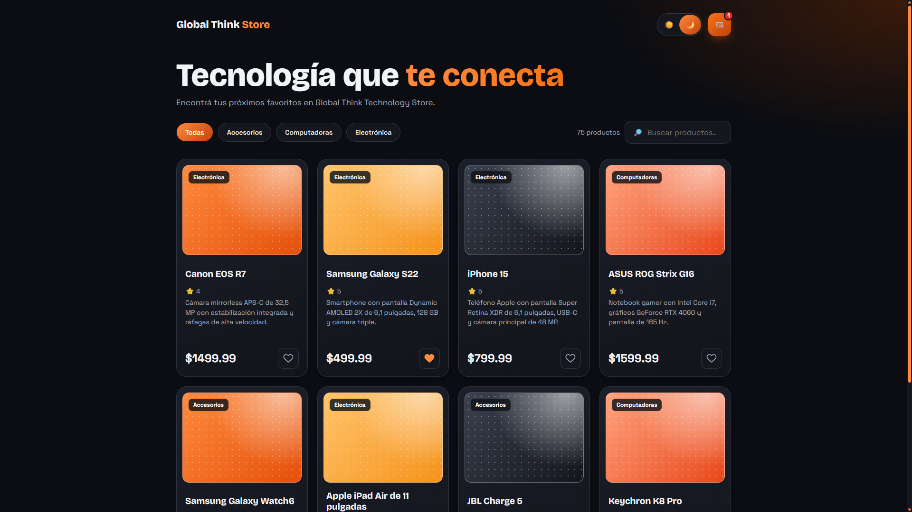
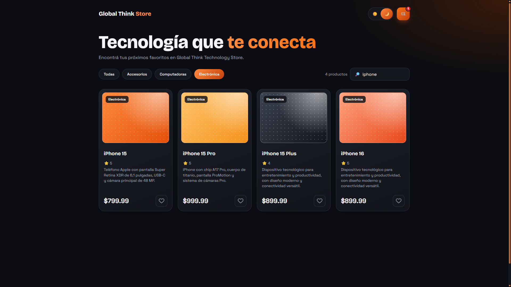
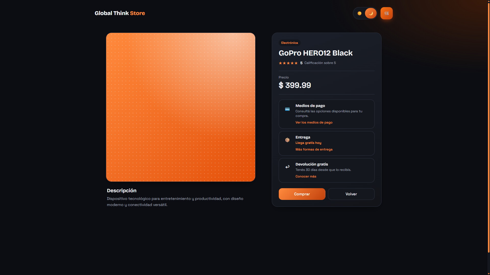
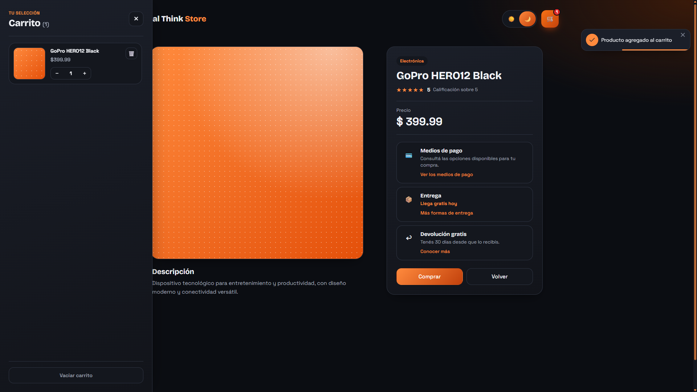
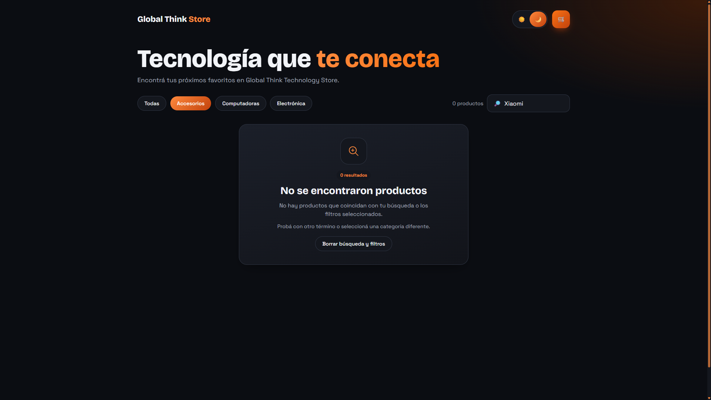
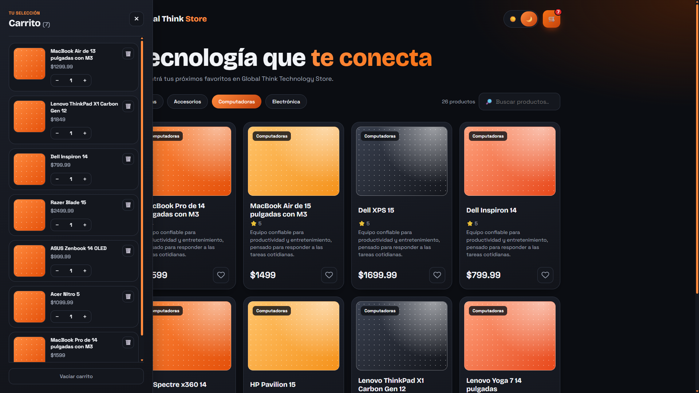

# Global Think Challenge Web

Tienda de productos informáticos para la entrevista técnica.

## Requisitos previos

Antes de comenzar, asegurate de tener instalado en tu máquina:

- [Node.js](https://nodejs.org/) (versión recomendada LTS)
- Un gestor de paquetes: `npm`, `yarn`, `pnpm` o `bun`

## Instalación

Cloná este repositorio en tu equipo y accedé al directorio del proyecto:

```bash
git clone <URL_DEL_REPOSITORIO>
cd global-think-challenge-web
```

Luego instalá las dependencias:

```bash
npm install
# o
yarn install
# o
pnpm install
# o
bun install
```

## Levantar el proyecto

Para iniciar el servidor de desarrollo, ejecutá:

```bash
npm run dev
# or
yarn dev
# or
pnpm dev
# or
bun dev
```

Una vez que el servidor esté corriendo, abrí tu navegador en [http://localhost:3000](http://localhost:3000).

### API local

Para iniciar la API de productos, ejecutá en otra terminal:

```bash
cd backend
npm install
npm start
```

La colección de productos queda disponible en [http://localhost:3001/products](http://localhost:3001/products) y las categorías en [http://localhost:3001/categories](http://localhost:3001/categories). Para consultar páginas de 8 productos, usá `http://localhost:3001/products?_page=1&_per_page=8`; json-server devuelve `data`, `pages` e `items` junto con los enlaces de navegación. También se pueden combinar filtros, por ejemplo `http://localhost:3001/products?_page=1&_per_page=8&titulo:contains=Canon&categoria=Electr%C3%B3nica`.

El backend muestra al iniciar los enlaces directos a cada endpoint. También registra cada petición con colores, método, ruta, código HTTP y duración, con una separación visual entre el mensaje de inicio y los logs.

En desarrollo local, el frontend toma la URL de json-server desde `NEXT_PUBLIC_API_URL`. Para un despliegue estático en Vercel, configurá `NEXT_PUBLIC_PRODUCTS_DATA_URL` con la URL pública de un `db.json`; por ejemplo: `https://raw.githubusercontent.com/NazarenoCarlesso/global-think-challenge-web/refs/heads/main/backend/db.json`. En ese modo el frontend descarga el JSON una vez y resuelve filtros, categorías y paginación en el navegador, sin necesitar un servidor json-server. Si ambas variables están definidas, la fuente JSON estática tiene prioridad. En Vercel, configurá la variable antes del build y volvé a desplegar.

Los favoritos y el carrito se guardan en el `localStorage` del navegador para conservarse al recargar la página.

### Deploy en Vercel


## Screenshots












